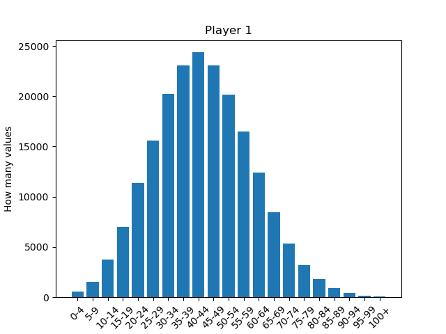
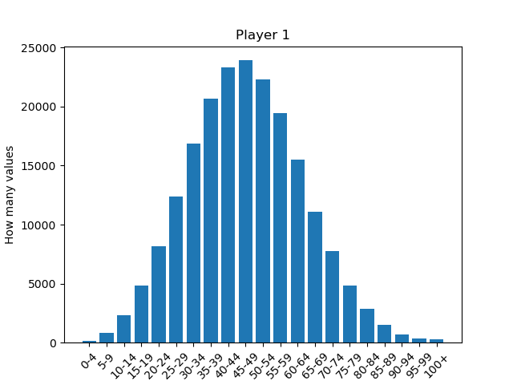
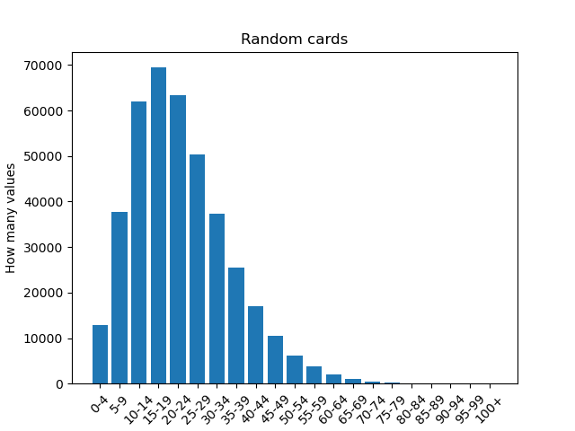

# Far Away - AI Card Game Learning Project

A reinforcement learning and rule-based AI system for the card game Far away.

## Game Overview

**Far Away** is a 2-player card game where players:
- Play cards from their hand to the table
- Pick cards from a shared board
- Build card synergies through conditions and point-scoring rules
- Earn bonus cards strategically to support their played cards

### Key Game Mechanics
- **8 turns per game**, alternating play and pick phases
- **77 regular cards** and **54 sanctuary (bonus) cards** with distinct properties:
  - Resources (stone, deer, pineapple)
  - Colors (blue, red, green, yellow, white)
  - Night symbols and parchment markers
  - Conditions that must be met to score points
  - Scoring rules (fixed points, resource multipliers, color sets, etc.)

---

## Setup

### Prerequisites

Install [Miniconda](https://docs.conda.io/) or Anaconda.

### 1. Create the environment

From the project folder (where `environment.yml` is located), run:

```bash
conda env create -f environment.yml
```

### 2. Activate the environment

```bash
conda activate far_away
```

---

## AI Implementations

### 1. Learning AI (Link-Based Reinforcement Learning)
**File:** `class_learning_IA.py` | **Runner:** `learning_IA.py`

This AI learns from **card relationships** rather than hand-written rules:
- Learns which card combinations are effective
- Identifies context links between already-played cards and new candidates
- Rewards cards that help complete conditions or create synergies
- Uses Q-learning with three value tables:
  - `q_table`: State-action pairs
  - `card_values`: Individual card type values
  - `link_values`: Contextual link strengths

**Latest Version (V3.1):**
- Mean score: **41.33** | Median: **41.0**
- Win rate: **81.3%** vs random opponent
- Memory: 599,535 learned links



---

### 2. Rule-Based Strategic AI
**File:** `scr/class_rule-based_strategic_AI.py` | **Runner:** `src/rule-based_strategic_AI.py`

Hard-coded strategy with multi-level decision logic:

**Strategy by Round:**
- **Rounds 1-2:** Play/pick cards with the largest conditions
- **Rounds 3-7:** Play cards that help complete unfinished conditions
  - Tie-breaker: Consider point-types of already-played cards
  - If multiple cards match, prefer card numbers higher than the last card played
- **Round 8 (final):** Override all strategy and play the card yielding the highest final score

**Best Performance (V5):**
- Mean score: **47.17** | Median: **47.0**
- Win rate: **83.8%** vs random opponent



---

## 📈 Performance Comparison

### Baseline: Random Card Selection
- Mean score: **22.79** | Median: **21.0**
- Win rate: **48.9%** (ties: 2.3%)



### Learning AI Progression

| Version | Mean Score | Win Rate | Key Features |
|---------|-----------|----------|--------------|
| V1      | 35.52     | 69.6%    | Learn card links |
| V2      | 37.93     | 73.7%    | Add sanctuary rewards |
| V3.0    | 38.65     | 75.1%    | Context link bonuses |
| **V3.1**| **41.33** | **81.3%**| **Penalty for useless choices** |


### Rule-Based Progression

| Version | Mean Score | Win Rate | Strategy Enhancement |
|---------|-----------|----------|----------------------|
| V3      | 41.84     | 76.8%    | Condition focus |
| V4      | 46.09     | 83.1%    | Smart sanctuary choice |
| **V5**  | **47.17** | **83.8%**| **Point-type tie-breaks** |

---

## How to Run

### Training the Learning AI
```bash
python new_IA.py
```
- Trains for 200,000 games by default
- Prints progress every 10,000 games
- Saves learned memory to `ai_memory_link_learning.pkl`
- Outputs score distributions and statistics

### Training the Rule-Based AI
```bash
python rule-based_strategic_AI.py
```
- Tests the hand-coded strategy across 200,000 games
- Outputs comparative statistics against random opponent
- Memory saved to `ai_memory_v4.pkl` (for Q-table compatibility)

---

## Project Structure


```text
Far_away/
├── results/
│   ├── learning_IA/
│   │   ├── ai_memory_link_learning.pkl
│   │   ├── training_log.txt
│   │   ├── summary.json
│   │   ├── scores.csv
│   │   ├── score_distribution_player1.png
│   │   └── score_distribution_player2.png
│   │
│   └── rule_based_strategic_IA/
│       ├── ai_memory_v4.pkl
│       ├── training_log.txt
│       ├── summary.json
│       ├── scores.csv
│       ├── score_distribution_player1.png
│       └── score_distribution_player2.png
│
└── src/
    ├── class_learning_IA.py
    ├── learning_IA.py
    ├── class_rule-based_strategic_AI.py
    └── rule-based_strategic_AI.py
```

---

## Learning Mechanism (Link-Based RL)

The learning AI rewards **card relationships** identified at the end of each game:

### Reward Types:
1. **Condition Links**: Cards that help complete unfinished conditions
   ```
   Condition card needs [2 stone, 1 deer, 0 pineapple]
   → Reward stone-providing cards based on need
   ```

2. **Point Links**: Cards that enable scoring rules
   ```
   Scoring card: ["night", 3] (3 points per night card)
   → Reward all night cards the AI collected
   ```

3. **Context Links**: Multiple cards synergizing together
   ```
   Card A supports condition; Card B, C, D also support it
   → Card with 3 links gets bigger reward than card with 1 link
   ```

4. **Sanctuary Help**: Explicit reward for sanctuary cards that unlock other cards
   ```
   Remove sanctuary → Other card loses points
   → Sanctuary gets direct reward for that loss
   ```

### Learning Curves:
- Q-table: `(state, mode, card_features) → estimated_value`
- Card Values: `(mode, card_features) → standalone_value`
- Link Values: `(mode, type, category, existing_card, candidate_card) → link_strength`

---

## Results Summary

Both implementations significantly outperform random play:

| Approach | Best Mean Score | Win Rate |
|----------|-----------------|----------|
| Random   | 22.79           | 48.9%    |
| Learning (V3.1) | 41.33    | 81.3%    |
| Rule-Based (V5) | 47.17    | 83.8%    |

The **rule-based AI performs is better**, but the **learning AI is adaptive** and could improve further with more training or tuned hyperparameters.

---

## 📄 License

This project is licensed under the **MIT License**.

## 👤 Author

AmauryBioCode
